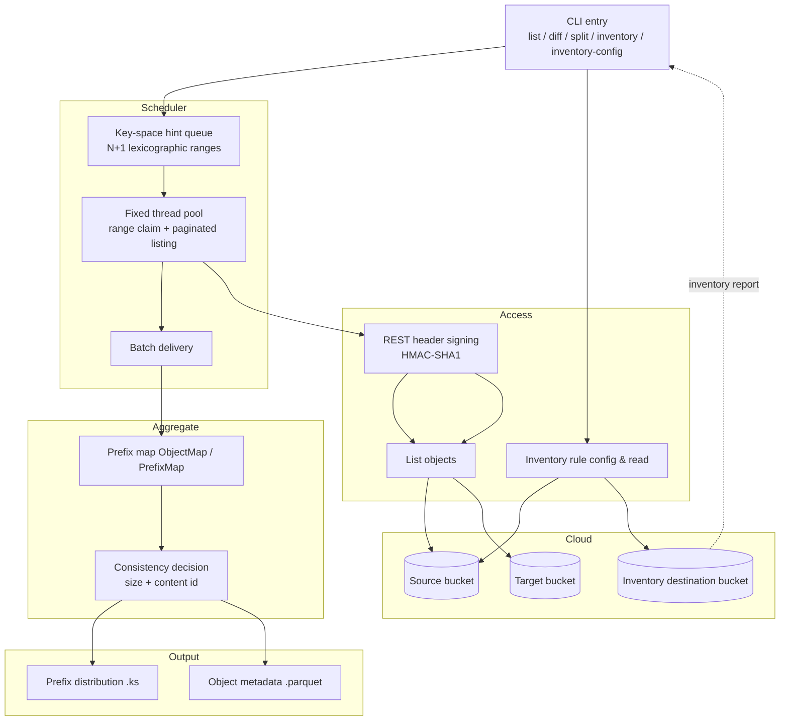

# obsfast · Concurrent Inventory and Differential Comparison for Object Storage Buckets

[](LICENSE)
[](https://www.huaweicloud.com/product/obs.html)
[](https://www.python.org/)
[](https://www.terraform.io/)

## Overview

`obsfast` is a command-line tool for very large object storage buckets. It replaces single-threaded sequential listing with **concurrent range-based listing**, compressing the time to inventory buckets with tens of millions to billions of objects from hours to minutes, and supports key-by-key differential comparison between two buckets.

It solves a direct problem: when a bucket holds too many objects, a single listing takes a long time and fails must be restarted from scratch; and knowing exactly which objects differ between two buckets (for example a production bucket and a disaster-recovery bucket) is impossible to do by hand.

This practice provides:

* Single-bucket concurrent inventory, exporting prefix distribution and object metadata;
* Dual-bucket concurrent comparison, exporting differences (annotated with a `DiffFlag`);
* Key-space splitting, dividing a large inventory task into parallelizable ranges;
* Bucket inventory rule management and report parsing, forming a complete chain of "fetch the inventory first, then precisely inventory".

It is suitable for operations and data-engineering teams that need capacity inventory, cross-bucket consistency checks, or pre/post data-migration verification.

## Architecture



Key point: the scheduler splits the key space into disjoint lexicographic ranges scanned in parallel; the access layer only lists and reads, and never writes business data; the aggregate layer groups by prefix and decides consistency key by key.

## Highlights

* **Zero third-party-dependency access layer**: header signing, REST calls, and XML parsing are all implemented with the standard library, with no cloud-vendor SDK, making it easy to distribute in restricted environments. `pyarrow` is only needed when exporting Parquet.
* **Range splitting instead of blindly raising concurrency**: run a light scan first to obtain the prefix distribution, then greedily split into balanced ranges based on object count, avoiding "high concurrency but everything stuck on one prefix".
* **Resumable error classification**: recoverable errors such as request timeout and connection timeout let the current range resume from the breakpoint; terminal errors such as missing bucket or insufficient permission exit the whole process.
* **Automatic encryption-scene detection**: before starting, the tool probes the bucket encryption mode; when KMS default encryption is detected, it automatically downgrades the consistency decision to "size only" and clearly annotates the conclusion scope, avoiding silent misjudgment.
* **Controlled filter expressions**: filter conditions go through a self-built recursive-descent parser with whitelists for variables and attributes; illegal expressions error at the startup stage rather than being evaluated dynamically.

## Cloud Services

| Cloud Service | Purpose |
|-|-|
| Object Storage Service (OBS) | Bucket listing, reading, and object metadata collection |
| Object Storage Service · Bucket Inventory | Periodically (daily / weekly) generates an object inventory report |
| Identity and Access Management (IAM) | Access credentials and bucket access permissions |
| Data Encryption Service (KMS, optional) | Bucket default encryption, affecting the consistency decision scope |

> Please release resources promptly after use to avoid unnecessary residual occupation. See [Cleanup](#cleanup) for details.

## Prerequisites

| Item | Requirement |
|-|-|
| Account permissions | Bucket create / list / read-write on object storage; read-write on bucket inventory rules |
| Python | 3.9 or above (the tool itself uses only the standard library) |
| Terraform | 1.5.0 or above |
| Region | `cn-north-4` by default |
| Network | Reachable to the object-storage endpoint of the target region |

Exporting Parquet requires `pyarrow`; no third-party package is needed otherwise.

## Quick Start

```bash
# 1) Prepare credentials
export HW_ACCESS_KEY="<access-key>"
export HW_SECRET_KEY="<secret-key>"
export HW_REGION="cn-north-4"

# 2) Create buckets
cd infra
cp terraform.tfvars.example terraform.tfvars
terraform init && terraform apply
cd ..

# 3) Run inventory
export PYTHONPATH="$(pwd)/src"
python3 -m obsfast list --bucket "$(cd infra && terraform output -raw source_bucket_name)" \
    --region cn-north-4 --output-ks-file out.ks --output-parquet-file out.parquet
```

## Deployment

### Step 1: Prepare credentials

Credentials are read only from environment variables and are never written to any configuration or output file:

```bash
export HW_ACCESS_KEY="<access-key>"
export HW_SECRET_KEY="<secret-key>"
export HW_REGION="cn-north-4"
```

### Step 2: Create buckets

```bash
cd infra
cp terraform.tfvars.example terraform.tfvars
terraform init
terraform apply
```

Expected output:

```
Apply complete! Resources: 3 added, 0 changed, 0 destroyed.

Outputs:

inventory_bucket_name = "obsfast-inventory-xxxxxxxx"
source_bucket_name = "obsfast-source-xxxxxxxx"
```

### Step 3: Prepare the runtime environment

```bash
cd ../src
python3 -m venv .venv && . .venv/bin/activate
pip install -r requirements.txt    # only when exporting Parquet
cd ..
export PYTHONPATH="$(pwd)/src"
python3 -m obsfast --help
```

### Step 4: Put data to be inventoried

Write several objects to the source bucket (by any upload method), then run the inventory following [Usage](#usage).

## Usage

### Single-bucket inventory

```bash
python3 -m obsfast list --bucket <source-bucket> --region cn-north-4 \
    --output-ks-file out.ks --output-parquet-file out.parquet
```

### Segmented inventory of large buckets

```bash
python3 -m obsfast list --bucket <source-bucket> --region cn-north-4 -k first.ks
python3 -m obsfast split --ks first.ks --count 64 --output hints.input
python3 -m obsfast list --bucket <source-bucket> --region cn-north-4 \
    --ks-file hints.input --concurrency 64 \
    --output-ks-file full.ks --output-parquet-file full.parquet
```

### Dual-bucket differential comparison

```bash
python3 -m obsfast diff --bucket <source-bucket> --target-bucket <target-bucket> \
    --region cn-north-4 --concurrency 4 \
    --output-ks-file diff.ks --output-parquet-file diff.parquet
```

Add `--include-equal` to also export objects that are consistent on both sides.

### Filter conditions

```bash
python3 -m obsfast list --bucket <source-bucket> --region cn-north-4 \
    --filter "SOURCE.size >= 100"
```

Available variables: `SOURCE` (for `list` and `diff`) and `TARGET` (for `diff` only). Available attributes: `size` and `last_modified`.

### Bucket inventory

```bash
python3 -m obsfast inventory-config --action set --bucket <source-bucket> \
    --id daily-inventory --destination-bucket <target-bucket> \
    --destination-prefix inventory-reports --frequency Daily --versions Current

python3 -m obsfast inventory \
    --manifest "obs://<target-bucket>/inventory-reports/<source-bucket>/daily-inventory/<date-dir>/manifest.json" \
    --region cn-north-4 -k inv.ks
```

### Verification

```bash
python3 - <<'PY'
import pyarrow.parquet as pq
table = pq.read_table("out.parquet")
print(table.schema)
print(table.num_rows)
PY
```

Self-check: `LastModified` should be a reasonable Unix second (not all zero); the `.ks` results of the segmented and single-segment inventories should match line by line.

> **After deployment, please verify each subcommand yourself following this chapter to confirm they run and the output matches the description before considering the delivery complete.**

## Cleanup

```bash
cd infra
terraform destroy
```

> Before destroying, delete the objects in the bucket first; a non-empty bucket will cause the destroy to fail. Also delete the inventory rule on the bucket to avoid continued report generation and residual artifacts.

## Detailed Reference

### Output format

**Prefix distribution file (`.ks`)**: each line is `"prefix","object-count"`.

**Object metadata (`.parquet`)**:

| Field | Type | Description |
|-|-|-|
| `Key` | string | Object key |
| `Size` | uint64 | Bytes |
| `LastModified` | uint64 | Unix seconds |
| `ETag` | string | Content id; under KMS encryption it is not the content MD5 |
| `DiffFlag` | uint8 | Difference conclusion |

`DiffFlag` values:

| Value | Meaning | Exported by default |
|-|-|-|
| 0 | Consistent on both sides | No (exported with `--include-equal`) |
| 1 | Only in source bucket | Yes |
| 2 | Only in target bucket | Yes |
| 3 | On both sides but metadata differs | Yes |

For a single-bucket `list`, all records are marked `1`.

### Common parameters

| Parameter | Default | Description |
|-|-|-|
| `--concurrency, -c` | 100 | Number of range tasks running concurrently |
| `--threads, -t` | 10 | Worker thread count |
| `--prefix, -p` | `/` | Starting prefix |
| `--ks-file, -k` | `{region}_{bucket}_ks_hints.input` | Key-space hint file |
| `--filter, -f` | none | Filter expression |
| `--endpoint-url` | derived from region | Custom service endpoint |
| `--path-style` | off | Force path-style addressing |
| `--no-sign-request` | off | Anonymous access to publicly readable buckets |
| `--include-equal` | off | Export objects consistent on both sides |
| `--no-etag-compare` | off | Decide consistency by size only |

### Consistency decision scope

The default scope is "compare size first, then content id". When a bucket uses KMS default encryption, the listed ETag is not the content MD5, and re-uploading the same content yields a different value. The tool then automatically downgrades to "size only" and prints a warning. After downgrade, "consistent on both sides" precisely means **size-consistent**, not that the content is identical.

### Constraints and limits

| Constraint | Description |
|-|-|
| List page size | 1000, fixed by the server |
| Inventory rules per bucket | At most 10 |
| Inventory frequency | Only `Daily` / `Weekly` |
| Inventory file format | Only `CSV` |
| Inventory destination bucket | Must not be a KMS-encrypted bucket |
| Endpoint style | Regional domain enforces virtual-hosted style; path style only for custom endpoints |

See [docs/architecture.md](docs/architecture.md) for the full design and [docs/deployment-guide.md](docs/deployment-guide.md) for deployment details.

## License

This practice is released under the MIT No Attribution license. See [LICENSE](LICENSE) for details.

## Contact

* Issue reporting: please open an Issue in this repository.
* Discussion: use the repository Issue area to discuss usage questions and improvement suggestions.

## Creator / Maintainer

| Role | Account |
|-|-|
| **Creator** | zhangcheng123321 |
| **Maintainer** | zhangcheng123321 |
