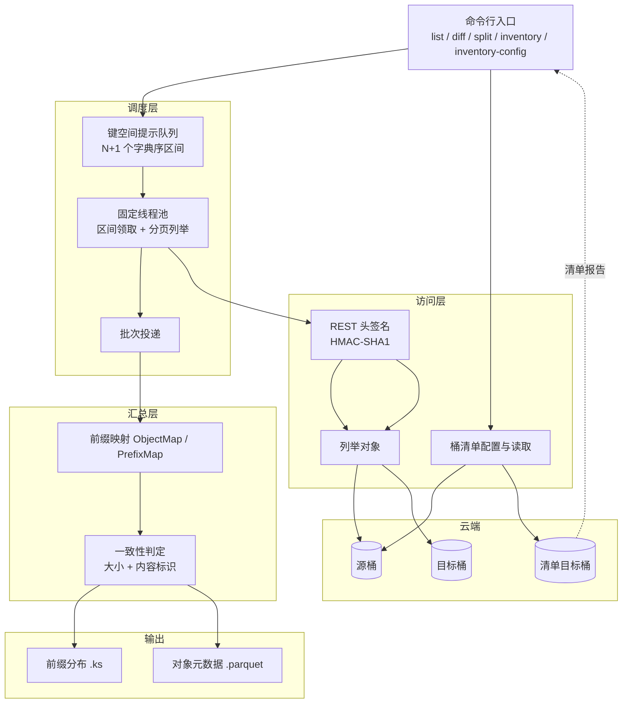

# obsfast · 对象存储桶并发盘点与差异比对

[](LICENSE)
[](https://www.huaweicloud.com/product/obs.html)
[](https://www.python.org/)
[](https://www.terraform.io/)

## 1. 简介

`obsfast` 是一个面向超大规模对象存储桶的命令行工具，用**并发分段列举**替代单线程顺序扫描，把千万级乃至十亿级对象的盘点时间从小时级压缩到分钟级，并支持两个桶之间的逐键差异比对。

它解决的问题很直接：桶里对象太多时，一次列举要跑很久，中途失败就得从头再来；想知道两个桶（例如生产桶与灾备桶）到底差了哪些对象，靠人肉对比更是不可能完成的任务。

本实践提供：

* 单桶并发盘点，导出前缀分布与对象元数据；
* 双桶并发比对，导出差异项（`DiffFlag` 标注差异类型）；
* 键空间切分，把大盘点任务拆成可并行的区间；
* 桶清单的配置管理与报告解析，让「先拿清单、再精准盘点」成为一条完整链路。

适用于需要做对象存储容量盘点、跨桶一致性核查、数据搬迁前后校验的运维与数据工程团队。

## 2. 目录

| 章节 | 内容 |
|-|-|
| [3. 架构图](#3-架构图) | 整体结构与数据流 |
| [4. 方案亮点](#4-方案亮点) | 本实践的核心设计取舍 |
| [5. 涉及云服务](#5-涉及云服务) | 用到的云服务 |
| [6. 前置条件](#6-前置条件) | 账号权限与工具版本 |
| [7. 快速开始](#7-快速开始) | 最短可运行路径 |
| [8. 分步部署](#8-分步部署) | 可复现的逐步操作 |
| [9. 使用方法](#9-使用方法) | 各子命令示例与验证 |
| [10. 清理资源](#10-清理资源) | 释放资源 |
| [11. 详细说明](#11-详细说明) | 输出格式与参数说明 |
| [12. 依赖](#12-依赖) | 依赖库 |
| [13. FAQ](#13-faq) | 常见问题 |
| [14. 贡献指南](#14-贡献指南) | 参与共建 |
| [15. 许可证](#15-许可证) | 许可声明 |
| [16. 联系方式](#16-联系方式) | 交流与反馈 |
| [17. 创建者 / 维护者](#17-创建者--维护者) | 作者与维护者 |

## 3. 架构图



要点：调度层把键空间切成互不相交的字典序区间并行扫描；访问层只做列举与读取，不写业务数据；汇总层按前缀聚合后逐键判定一致性。

## 4. 方案亮点

* **零第三方依赖的访问层**：头签名、REST 调用、XML 解析全部用标准库实现，不引入任何云厂商 SDK，便于在受限环境分发。仅在导出 Parquet 时需要 `pyarrow`。
* **区间切分而非盲目加并发**：先跑一轮轻量扫描拿到前缀分布，再按对象数量贪心切分成均衡区间，避免「并发开了很高却全挤在同一个前缀上」。
* **可续跑的错误分类**：请求超时、连接超时等可恢复错误让当前区间从断点继续；桶不存在、权��不足等终止性错误才整体退出。
* **自动识别加密场景**：开跑前探测桶的加密方式，遇到 KMS 默认加密时自动把一致性判定降级为「仅按大小」，并明确标注结论口径，避免静默误判。
* **受控的过滤表达式**：过滤条件走自研的递归下降解析器，变量与属性均有白名单，非法表达式在启动阶段就报错，不做动态求值。

## 5. 涉及云服务

| 云服务 | 用途 |
|-|-|
| 对象存储服务（OBS） | 桶的列举、读取，对象元数据采集 |
| 对象存储服务 · 桶清单 | 按日 / 周周期生成桶内对象清单报告 |
| 统一身份认证服务（IAM） | 访问凭据与桶访问权限 |
| 数据加密服务（KMS，可选） | 桶默认加密，影响一致性判定口径 |

> 资源使用后请及时释放，避免长期残留造成不必要的占用。释放方式见[第 10 章](#10-清理资源)。

## 6. 前置条件

| 项目 | 要求 |
|-|-|
| 账号权限 | 对象存储的桶创建、列举、读写权限；桶清单规则的读写权限 |
| Python | 3.9 及以上（工具本体仅用标准库） |
| Terraform | 1.5.0 及以上 |
| 区域 | 默认 `cn-north-4` |
| 网络 | 可访问目标区域的对象存储服务端点 |

导出 Parquet 需要 `pyarrow`；不导出时无需安装任何第三方包。

## 7. 快速开始

```bash
# 1) 准备凭据
export HW_ACCESS_KEY="<访问键>"
export HW_SECRET_KEY="<密钥>"
export HW_REGION="cn-north-4"

# 2) 创建桶
cd infra
cp terraform.tfvars.example terraform.tfvars
terraform init && terraform apply
cd ..

# 3) 运行盘点
export PYTHONPATH="$(pwd)/src"
python3 -m obsfast list --bucket "$(cd infra && terraform output -raw source_bucket_name)" \
    --region cn-north-4 --output-ks-file out.ks --output-parquet-file out.parquet
```

## 8. 分步部署

### 步骤 1：准备凭据

凭据只从环境变量读取，不会写入任何配置文件或输出文件：

```bash
export HW_ACCESS_KEY="<访问键>"
export HW_SECRET_KEY="<密钥>"
export HW_REGION="cn-north-4"
```

### 步骤 2：创建桶

```bash
cd infra
cp terraform.tfvars.example terraform.tfvars
terraform init
terraform apply
```

预期输出：

```
Apply complete! Resources: 3 added, 0 changed, 0 destroyed.

Outputs:

inventory_bucket_name = "obsfast-inventory-xxxxxxxx"
source_bucket_name = "obsfast-source-xxxxxxxx"
```

### 步骤 3：准备运行环境

```bash
cd ../src
python3 -m venv .venv && . .venv/bin/activate
pip install -r requirements.txt    # 仅需导出 Parquet 时执行
cd ..
export PYTHONPATH="$(pwd)/src"
python3 -m obsfast --help
```

预期输出：

```
usage: obsfast [-h] [-V] <命令> ...

对象存储桶的并发盘点与差异比对工具

positional arguments:
  <命令>
    list              单桶并发盘点并导出结果
    diff              双桶并发盘点并比对结果
    split             把前缀分布文件切分为键空间提示
    inventory         解析桶清单报告并转换为前缀分布
    inventory-config  配置 / 查看 / 删除桶清单规则
```

### 步骤 4：放入待盘点数据

向源桶写入若干对象（可用任意方式上传），随后按[第 9 章](#9-使用方法)执行盘点。

## 9. 使用方法

### 9.1 单桶盘点

```bash
python3 -m obsfast list --bucket <源桶名> --region cn-north-4 \
    --output-ks-file out.ks --output-parquet-file out.parquet
```

预期输出（节选）：

```
盘点结束：prefix count 8, object count 9
  请求统计：对象 9 个 / 分页 1 次 / 续跑 0 / 连接超时 0 / 其他错误 0
对象元数据已导出至 out.parquet（9 行）
运行模式：单桶盘点
前缀数量：8
对象数量：9
```

### 9.2 大规模桶的分段盘点

```bash
python3 -m obsfast list --bucket <源桶名> --region cn-north-4 -k first.ks
python3 -m obsfast split --ks first.ks --count 64 --output hints.input
python3 -m obsfast list --bucket <源桶名> --region cn-north-4 \
    --ks-file hints.input --concurrency 64 \
    --output-ks-file full.ks --output-parquet-file full.parquet
```

第二步预期输出：

```
键空间提示文件：hints.input（3 个切分点，覆盖 9 个对象，源前缀 8 个）
```

### 9.3 双桶差异比对

```bash
python3 -m obsfast diff --bucket <源桶名> --target-bucket <目标桶名> \
    --region cn-north-4 --concurrency 4 \
    --output-ks-file diff.ks --output-parquet-file diff.parquet
```

预期输出（节选）：

```
  一致性口径：对象大小 + 内容标识（ETag）
盘点结束：prefix count 11, object count 13
  DiffFlag=1（仅源桶存在）：5 条
  DiffFlag=2（仅目标桶存在）：4 条
  DiffFlag=3（两侧都有但元数据不一致）：2 条
```

加 `--include-equal` 可同时导出两侧一致的对象。

### 9.4 过滤条件

```bash
python3 -m obsfast list --bucket <源桶名> --region cn-north-4 \
    --filter "SOURCE.size >= 100"
```

可用变量 `SOURCE`（`list` 与 `diff`）与 `TARGET`（仅 `diff`），可用属性 `size` 与 `last_modified`。

### 9.5 桶清单

```bash
python3 -m obsfast inventory-config --action set --bucket <源桶名> \
    --id daily-inventory --destination-bucket <目标桶名> \
    --destination-prefix inventory-reports --frequency Daily --versions Current

python3 -m obsfast inventory \
    --manifest "obs://<目标桶名>/inventory-reports/<源桶名>/daily-inventory/<日期目录>/manifest.json" \
    --region cn-north-4 -k inv.ks
```

### 9.6 验证方法

```bash
python3 - <<'PY'
import pyarrow.parquet as pq
table = pq.read_table("out.parquet")
print(table.schema)
print(table.num_rows)
PY
```

预期 schema：

```
Key: string not null
Size: uint64 not null
LastModified: uint64 not null
ETag: string not null
DiffFlag: uint8 not null
```

自查要点：`LastModified` 应为合理的 Unix 秒（非全 0）；分段盘点与单段盘点的 `.ks` 结果应逐行一致。

> **部署完成后请按本章步骤自行验证，确认各子命令可运行、输出与描述一致、功能可用，方可视为交付完成。**

## 10. 清理资源

```bash
cd infra
terraform destroy
```

> 销毁前请先删除桶内对象，非空桶会导致销毁失败；同时记得删除桶上的清单规则，避免后续继续产出清单文件造成残留。

## 11. 详细说明

### 11.1 输出格式

**前缀分布文件（`.ks`）**：每行 `"前缀","对象数"`。

```
"/","1"
"alpha","1"
"data/2024","2"
```

**对象元数据（`.parquet`）**：

| 字段 | 类型 | 说明 |
|-|-|-|
| `Key` | string | 对象键 |
| `Size` | uint64 | 字节数 |
| `LastModified` | uint64 | Unix 秒 |
| `ETag` | string | 内容标识；KMS 加密场景下不等于内容 MD5 |
| `DiffFlag` | uint8 | 差异结论 |

`DiffFlag` 取值：

| 值 | 含义 | 默认导出 |
|-|-|-|
| 0 | 两侧一致 | 否（加 `--include-equal` 时导出） |
| 1 | 仅源桶存在 | 是 |
| 2 | 仅目标桶存在 | 是 |
| 3 | 两侧都有但元数据不一致 | 是 |

单桶 `list` 时所有记录标记为 `1`。

### 11.2 常用参数

| 参数 | 默认 | 说明 |
|-|-|-|
| `--concurrency, -c` | 100 | 并发进行的区间任务数 |
| `--threads, -t` | 10 | 工作线程数 |
| `--prefix, -p` | `/` | 起始前缀 |
| `--ks-file, -k` | `{区域}_{桶名}_ks_hints.input` | 键空间提示文件 |
| `--filter, -f` | 无 | 过滤表达式 |
| `--endpoint-url` | 按区域推导 | 自定义服务端点 |
| `--path-style` | 关 | 强制路径风格寻址 |
| `--no-sign-request` | 关 | 匿名访问公开可读的桶 |
| `--include-equal` | 关 | 导出两侧一致的对象 |
| `--no-etag-compare` | 关 | 只按大小判定一致性 |

### 11.3 一致性判定口径

默认口径为「先比大小、再比内容标识」。当桶使用 KMS 默认加密时，列举结果中的 ETag 不等于对象内容的 MD5，且同一内容重复上传会得到不同取值，此时工具会自动降级为「仅按大小判定」并打印告警。降级后「两侧一致」的准确含义是**大小一致**，不包含内容是否相同的结论。

### 11.4 约束与限制

| 约束 | 说明 |
|-|-|
| 列举单页上限 | 1000，由服务端固定 |
| 清单规则数量 | 每桶最多 10 条 |
| 清单生成频率 | 仅 `Daily` / `Weekly` |
| 清单文件格式 | 仅 `CSV` |
| 清单目标桶 | 不能是 KMS 加密桶 |
| 端点风格 | 区域域名强制虚拟主机风格；路径风格仅适用于自定义端点 |

完整设计说明见 [docs/architecture.md](docs/architecture.md)，部署细节见 [docs/deployment-guide.md](docs/deployment-guide.md)。

## 12. 依赖

运行时依赖：

* **Python 标准库** —— 头签名、REST 调用、XML 解析、并发调度全部基于标准库实现；
* **PyArrow**（可选，`>=14.0`）—— 仅在导出 Parquet 时使用。

## 13. FAQ

**Q：并发度开到多大合适？**
A：先用 `list` 跑一轮轻量扫描拿到前缀分布，再用 `split` 切成与 `--concurrency` 相当的段数。盲目把并发度调到很高但区间只有一个，并不会加速。

**Q：为什么差异比对结果里几乎所有对象都被判为不一致？**
A：检查桶是否启用了 KMS 默认加密。该场景下 ETag 不可比，工具会自��降级为「仅按大小判定」并打印口径提示，请以提示为准。

**Q：提示文件为什么没生效？**
A：提示文件的格式是**每行一个前缀**。若传入的是前缀分布文件（CSV 行），也能被兼容解析，但请注意日志中「载入 N 个前缀提示」的数量是否符合预期。

**Q：报 `403 VirtualHostDomainRequired` 怎么办？**
A：区域域名强制要求虚拟主机风格寻址，去掉 `--path-style` 即可；只有在访问自定义端点时才应使用路径风格。

**Q：清单文件什么时候能生成？**
A：配置规则后约 1 小时内产出首次清单文件，报告文件随后 1~2 小时产出。

## 14. 贡献指南

欢迎提交问题反馈与改进建议。参与共建前请先阅读 [CONTRIBUTING.md](CONTRIBUTING.md)；提交代码请确保：

* 新增代码保持零第三方依赖（除 Parquet 导出外）；
* 关键行为变更同步更新 `docs/` 下的说明文档；
* 提交内容不含任何真实凭据。

## 15. 许可证

本实践采用 MIT No Attribution 许可证，详见 [LICENSE](LICENSE)。

## 16. 联系方式

* 问题反馈：请在本仓库提交 Issue
* 交流渠道：通过仓库 Issue 区讨论使用问题与改进建议

## 17. 创建者 / 维护者

| 角色 | 账号 |
|-|-|
| **创建者** | zhangcheng123321 |
| **维护者** | zhangcheng123321 |
